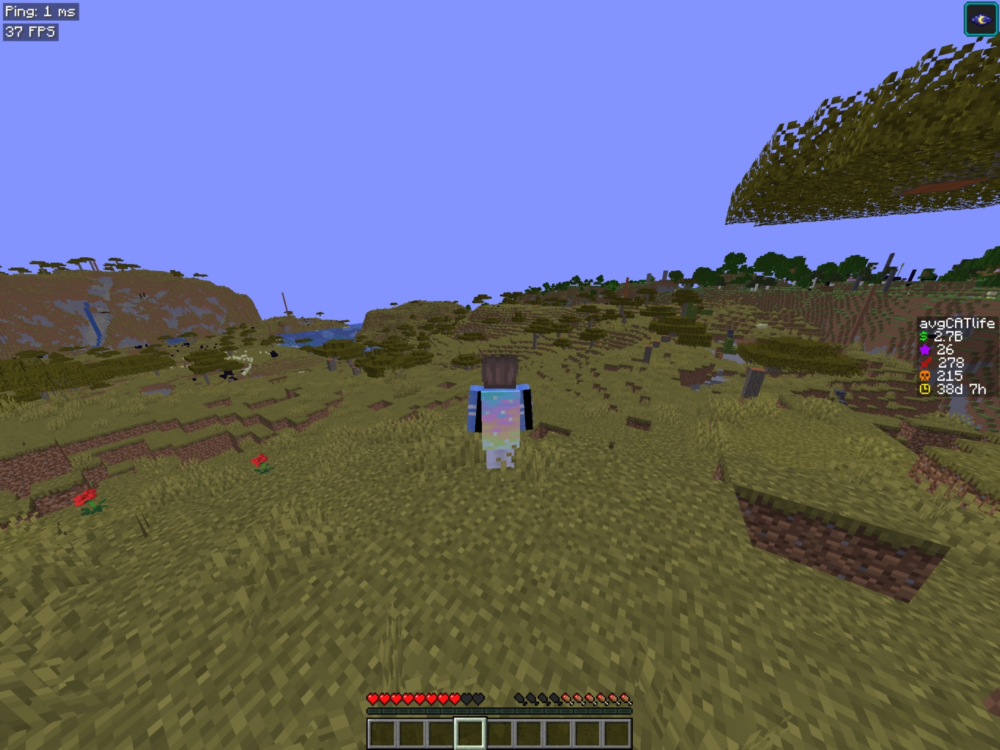
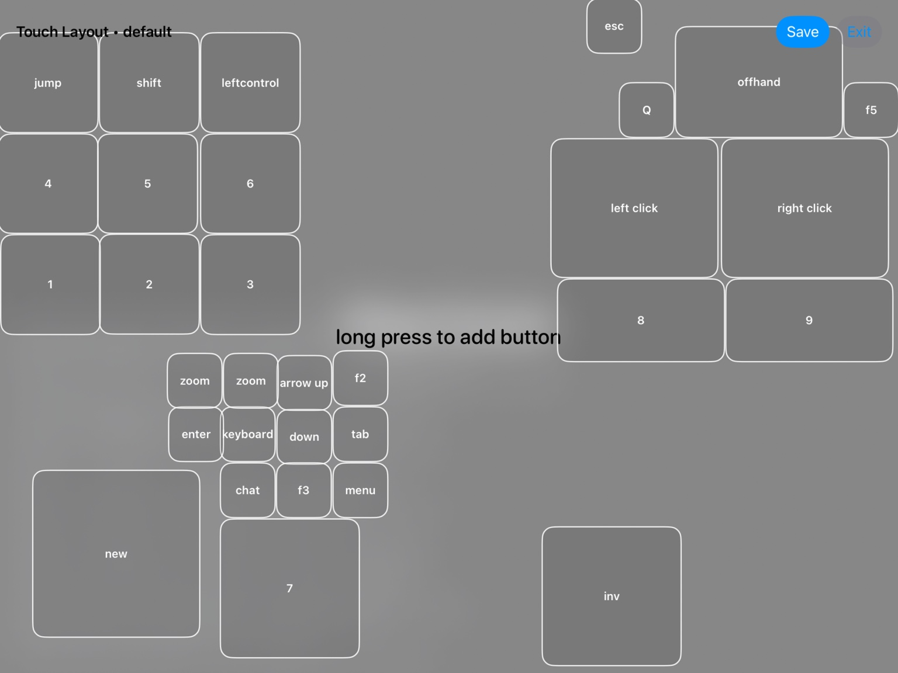
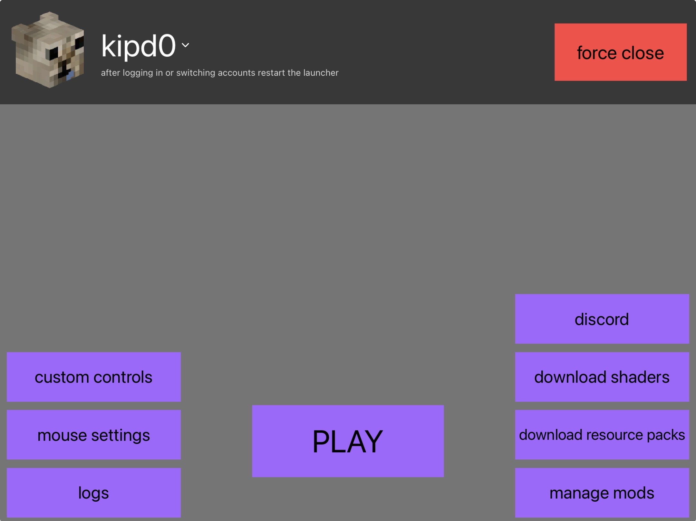

# Nova

**Minecraft Java Edition on iOS and iPadOS, powered by [Horizon](https://github.com/horizon-rust/horizon)**

**[Discord](https://discord.gg/aH9mtNDc24).**

Nova is an iPhone and iPad launcher for Horizon, a Minecraft Java Edition implementation written in Rust. It adds a touch interface, account management, and game file tools for iOS while keeping the core game close to upstream Horizon.

> **Project status:** Nova is in development. Some game features, mods, resource packs, and shader packs may not work as expected.

## Screenshots

### Gameplay on an older iPad

*DonutSMP at 32-chunk render distance on an iPad (8th generation, released in 2020). The screenshot shows one moment, not an average FPS benchmark.*

### Fully customizable touch controls

*Add, move, resize, copy, or remove on-screen controls. Assign keyboard keys, mouse buttons, or a movement joystick, ability to hide on-screen controls from recording. Save and load your own layouts.*

### iOS launcher

*Launch the game, manage Minecraft accounts, edit controls, change mouse settings, view logs, manage mods, and download resource packs or shader pack ZIP files from Modrinth.*

## Features

- **Minecraft Java Edition on iOS/iPadOS** using Horizon's native Rust game engine.
- **Multiplayer** with supported Minecraft Java Edition servers.
- **Touch controls:** custom buttons, keyboard mappings, mouse clicks, a movement joystick, and saved layouts.
- **Mouse settings** for touch and pointer input.
- **Microsoft account sign-in** and switching between saved Minecraft accounts. Restart Nova after changing accounts.
- **Mod manager** to list, enable, and disable installed Horizon mods.
- **Modrinth browser** to download resource pack and shader pack ZIP files.
- **Accessible game files** in the iOS Files app, including saves, options, packs, and logs.
- **Exportable logs** for troubleshooting.

## Mod support

Nova uses **Horizon mods**, not the Java mod loaders used by the official Minecraft Java client.

| Mod type | Support on Nova iOS |
| --- | --- |
| **Horizon WebAssembly mods (`.hmod`)** | **Supported** when built for a compatible Horizon/Nova mod API and using supported hooks. |
| **Horizon content mods packaged as compatible `.hmod` files** | **Supported** when their required features are available in the iOS WASM runtime. |
| **Horizon native-code mods** | **Not directly supported** by the iOS mod installer. These require native compilation or integration. |
| **Fabric / Forge / NeoForge `.jar` mods** | **Not supported directly.** They need a separate port to Horizon. |
| **Java mods** | **Not supported directly.** Nova does not run Java mod JARs. |
| **Mods that need missing Horizon hooks or unsupported WASM features** | **Not supported until the required engine/API support is added.** |

A `.hmod` file is not guaranteed to work just because it can be installed. Compatibility depends on the mod, the Horizon version, and the features it uses. A mod may work in multiplayer but not in singleplayer, or the reverse.

**Install a Horizon mod:**

1. Copy a compatible `.hmod` file to `Files → Nova → Game → horizon-mods`.
2. Open **Manage mods** in Nova and enable it.
3. Restart the game so the mod setting takes effect.

To build a Horizon WASM mod, see the [Horizon WASM mod guide](https://github.com/horizon-rust/horizon/blob/main/docs/modding/src/start/first-wasm-mod.md). The build tool and SDK must match the game version you use.

## Resource packs and shaders

In the launcher, select **Download resource packs** or **Download shaders** to search Modrinth and save a ZIP file.

- Resource pack ZIP files are saved in `Files → Nova → Game → resourcepack`.
- Shader pack ZIP files are saved in `Files → Nova → Game → shaderpack`.
- Downloads are checked against their published SHA-512 hash.

**Important:** A file being downloadable does not mean its format is supported by Horizon's renderer. Resource packs depend on game-version and format compatibility. Downloading a shader pack is **not** a guarantee that an Iris/OptiFine shader will render in Nova.

## Getting started

1. Get or build a Nova IPA from this repository's [GitHub Actions](https://github.com/kipd0/nova-ios/actions).
2. Install the IPA on your iPhone or iPad with a compatible sideloading method.
3. Prepare your own supported Minecraft game resources and import the prepared ZIP when Nova requests it.
4. Open Nova, select an account if needed, and press **Play**.
5. Use the launcher to customize your touch layout or access the game folder through the Files app.

Nova does not include Minecraft game assets in the IPA. The user supplies their own prepared resources.

## Project structure

| Path | Purpose |
| --- | --- |
| [`platforms/ios/`](platforms/ios/) | iOS launcher, touch controls, game host, and file import tools. |
| [`crates/`](crates/) | Horizon game engine, networking, rendering, and mod APIs. |
| [`.github/workflows/`](.github/workflows/) | Automated builds and iOS packaging workflows. |
| [`docs/modding/`](docs/modding/) | Horizon mod development documentation. |

## Credits and links

- **Game engine:** [Horizon](https://github.com/horizon-rust/horizon) and its contributors.
- **Mods and packs:** [Modrinth](https://modrinth.com/) provides the search and download source used by the launcher.
- **Community:** [Nova Discord](https://discord.gg/aH9mtNDc24).

Nova is an independent community project. It is not affiliated with or endorsed by Mojang Studios or Microsoft.
